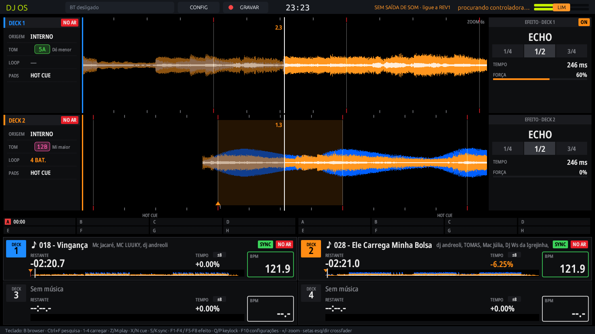
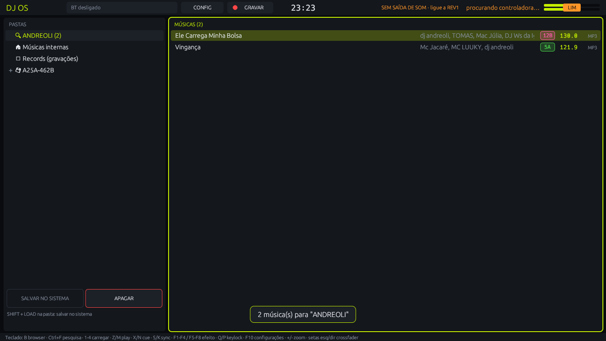
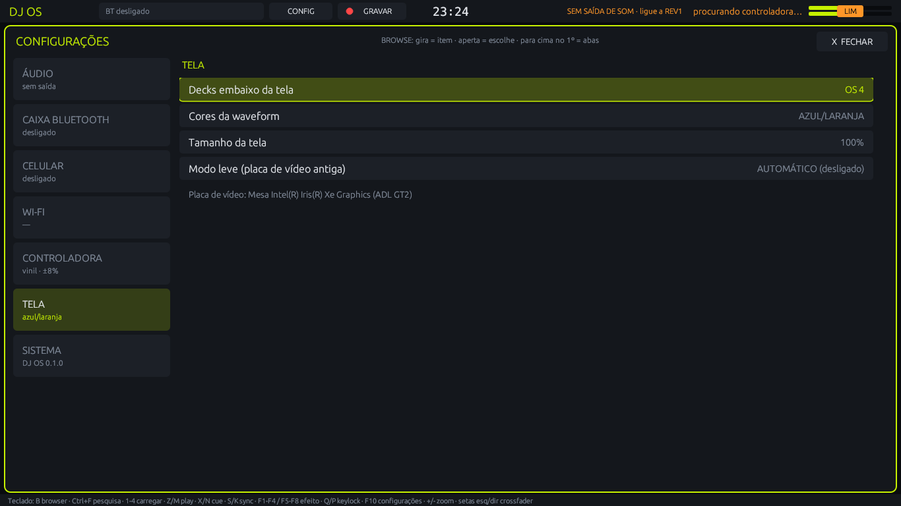
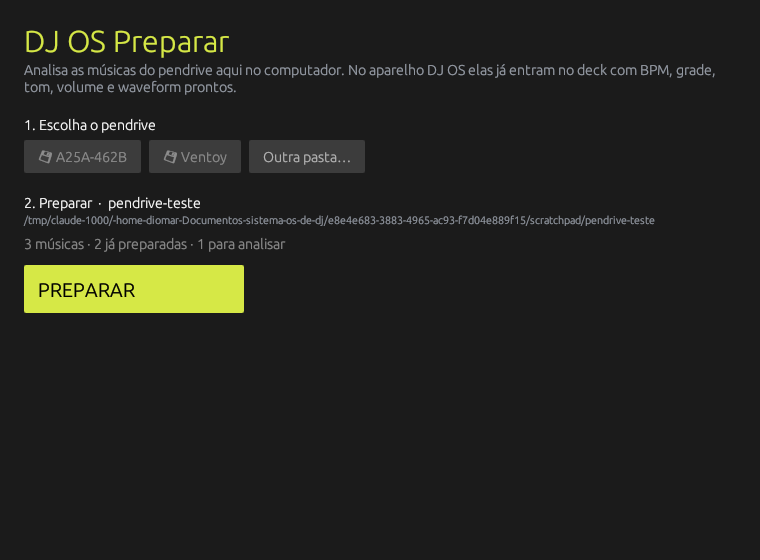

# DJ OS

Sistema de DJ livre, de dois jeitos:

- **Aparelho:** transforma um computador comum e uma controladora num aparelho **all-in-one**, no
  estilo dos players de cabine. Liga direto no sistema, sem área de trabalho, com waveforms,
  efeitos, pendrive, Bluetooth e atualização de firmware.
- **Programa para PC (Linux e Windows):** o mesmo DJ OS num computador normal, com a controladora
  ligada no USB.

> **Estado:** em desenvolvimento (versão 0.1). Testado com a **Pioneer DDJ-REV1**. Mais 21
> controladoras (Pioneer DDJ, CDJ e XDJ, Numark, Hercules, Denon, Reloop) vêm com mapeamento
> **em teste**: feito pela documentação, falta alguém com o aparelho confirmar.

| Pesquisa e browser | Configurações |
|---|---|
|  |  |

## O que tem
- 4 decks com waveform colorida, cue estilo CDJ, hotcues, loops, roll, beat jump, sync, keylock
  e scratch.
- O que se usa nas CDJs: QUANTIZE, slip, reverse, medidor de fase, contagem até o próximo cue,
  aviso de fim da música, trava do LOAD com o deck no ar, instant doubles (clonar o deck) e busca
  pela agulha na música inteira.
- Automix, play na batida, troca e casamento de tom, "combina com o que toca", playlists .m3u,
  filtros e os efeitos ROLL, CRUSH, BRAKE e BACKSPIN.
- Mixer com EQ, filtro e efeitos por canal sincronizados à batida.
- Browser com pesquisa por teclado virtual; músicas direto do pendrive ou guardadas no aparelho,
  com BPM, tom e volume analisados ao carregar no deck.
- Pendrive preparado no computador de casa com o **DJ OS Preparar** (Windows e Linux), como no
  rekordbox: a análise vai junto no pendrive e o aparelho não precisa analisar nada na hora de tocar.
- Leve: feito para rodar em computador velho (testado num notebook de 2011 com Intel HD 3000),
  com controle de temperatura do processador.
- Saídas da controladora (master e fone) e caixa Bluetooth ao mesmo tempo (master ou retorno).
- Celular por Bluetooth como fonte de som (num deck ou no master).
- Aparelho: liga direto no sistema, instala pelo pendrive e se atualiza por firmware assinado,
  voltando sozinho para a versão anterior se a nova não ligar.
- **Controladoras por arquivo**: cada uma é um arquivo de texto (`.djosmap`) com uma linha por
  botão; dá para corrigir ou fazer o seu sem programar ([como mapear](docs/mapeamento.md)) ou
  ensinar botão por botão em CONFIG → CONTROLADORA (**MIDI learn**).
- **Skins por arquivo** (`.djosskin`): cores e layout da tela; vêm Preta, Clara, Neon e
  Waveform grande ([como fazer uma skin](docs/skins.md)).

## Controladoras

| Marca | Modelos | Situação |
|---|---|---|
| Pioneer DJ | DDJ-REV1 | testada |
| Pioneer DJ | DDJ-400, DDJ-FLX4, DDJ-SB3, DDJ-FLX6, DDJ-SR2, DDJ-1000 | em teste |
| Pioneer DJ (modo USB/MIDI) | CDJ-2000NXS2, CDJ-3000, CDJ-900NXS, XDJ-RX2, XDJ-RX3, XDJ-XZ | em teste |
| Numark | Mixtrack Pro 3, Mixtrack Platinum FX, Party Mix | em teste |
| Hercules | DJControl Inpulse 200, 300, 500 | em teste |
| Denon DJ | MC7000, MC6000MK2 | em teste |
| Reloop | Beatmix 4 | em teste |

Tem uma dessas? Teste e conte como foi numa issue: com a sua ajuda ela passa para "testada". A sua
não está na lista? Dá para mapear com o [guia](docs/mapeamento.md) ou com o MIDI learn.

## Instalar
1. Baixe `dj-os-<versão>.iso` e grave num pendrive (ou copie para um pendrive com
   [Ventoy](https://www.ventoy.net)).
2. Ligue o computador pelo pendrive e escolha:
   - **testar sem instalar**: roda do pendrive, nada é gravado no computador;
   - **INSTALAR NO DISCO**: apaga o disco escolhido e instala o DJ OS.
3. Para atualizar um aparelho instalado: coloque o `dj-os-firmware-<versão>.djos` num pendrive e
   use **CONFIG → SISTEMA → Atualizar firmware**.

Requisitos do aparelho: PC x86-64 com 4 GB de RAM e disco de 16 GB ou mais. Ligue o computador no
modo **UEFI** (em algumas máquinas o modo antigo Legacy/CSM não liga o sistema instalado).

### DJ OS para PC (Linux e Windows)

Baixe em Releases o **`DJ-OS-PC-….AppImage`** (Linux: botão direito → Propriedades → "Permitir
executar", depois dois cliques) ou o **`DJ-OS-PC-….exe`** (Windows). Ligue a controladora no USB e
abra. O som sai pela controladora (master e fone); para escolher outra placa, CONFIG → ÁUDIO →
Saída do som. As músicas da pasta Música e os pendrives e HDs aparecem no browser (tecla **B** ou
SHIFT + BROWSE). No PC o DJ OS não mexe no Wi-Fi, no Bluetooth nem desliga o computador.

### DJ OS Preparar (computador de casa)

Baixe em Releases o **`DJ-OS-Preparar-….exe`** (Windows) ou o **`DJ-OS-Preparar-….AppImage`**
(Linux: clique com o botão direito → Propriedades → "Permitir executar", depois dois cliques).
Escolha o pendrive e clique em **PREPARAR**. Músicas já preparadas são puladas; dá para parar e
continuar depois.

## Para quem desenvolve
- Programa em Rust: o aparelho em `src/` (`cargo run --release`), a análise das músicas em
  `analise/` (compartilhada) e o DJ OS Preparar em `preparar/` (`cargo run --release -p dj-os-preparar`). Guia da controladora em
  [docs/mapeamento-ddj-rev1.md](docs/mapeamento-ddj-rev1.md); para acrescentar outra controladora,
  [docs/controladoras.md](docs/controladoras.md); mapeamentos em `mapeamentos/` e skins em
  `skins/` (vão dentro do programa).
- ISO e firmware: `iso/construir.sh` (Ubuntu 24.04 mínimo, sem precisar de sudo). Versões e
  lançamento em [docs/versoes.md](docs/versoes.md); testes em
  [docs/desenvolvimento/testes.md](docs/desenvolvimento/testes.md).
- Para compilar sem os pacotes de desenvolvimento do ALSA, o `dev-shim/` e o `.cargo/config.toml`
  já resolvem.

## Licença
[GPL-3.0](LICENSE): pode usar, estudar, modificar e distribuir; quem distribuir uma versão
modificada precisa manter a mesma licença e abrir o código dela também.

DJ OS não tem relação com a Pioneer DJ ou AlphaTheta; os nomes de produtos citados pertencem aos
seus donos e aparecem só para dizer com qual hardware o sistema funciona.
