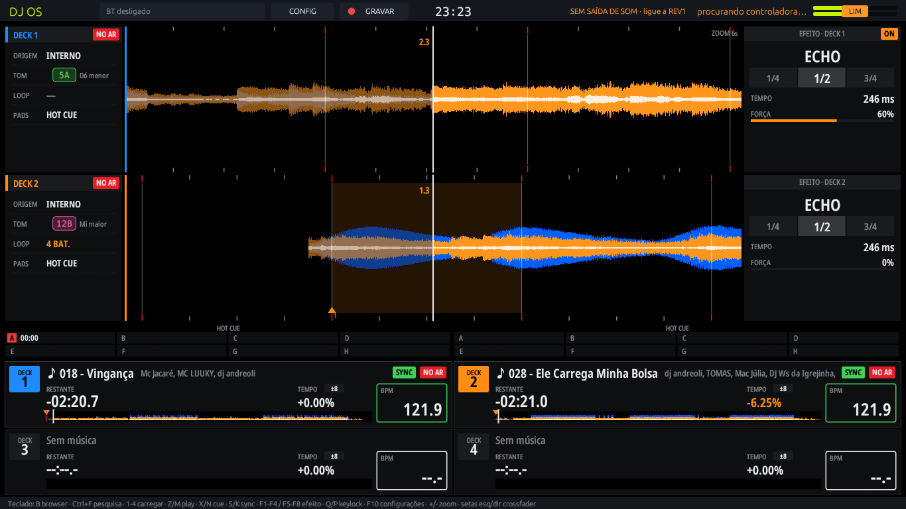
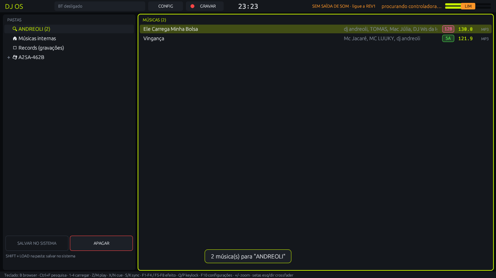
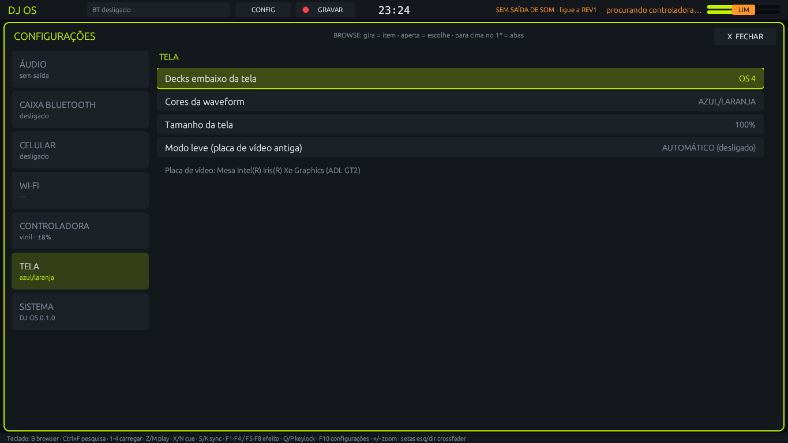

# DJ OS

Sistema operacional de DJ: transforma um computador comum e uma controladora num aparelho
**all-in-one**, no estilo dos players de cabine. Liga direto no sistema, sem área de trabalho,
com waveforms, efeitos, pendrive, Bluetooth e atualização de firmware.

> **Estado:** em desenvolvimento (versão 0.1). Hoje funciona com a **Pioneer DDJ-REV1**; outras
> controladoras estão no [roteiro](docs/ROADMAP.md).

| Pesquisa e browser | Configurações |
|---|---|
|  |  |

## O que tem
- 4 decks com waveform colorida, cue estilo CDJ, hotcues, loops, roll, beat jump, sync, keylock
  e scratch.
- Mixer com EQ, filtro e efeitos por canal sincronizados à batida.
- Browser com pesquisa por teclado virtual; músicas direto do pendrive ou guardadas no aparelho,
  com BPM, tom e volume analisados ao carregar no deck.
- Pendrive preparado no computador de casa, como no rekordbox: a análise vai junto no pendrive e
  o aparelho não precisa analisar nada na hora de tocar (o app com janela para Windows e Linux está
  sendo feito; hoje é `dj-os --preparar-pendrive <pasta do pendrive>`).
- Leve: feito para rodar em computador velho (testado num notebook de 2011 com Intel HD 3000),
  com controle de temperatura do processador.
- Saídas da controladora (master e fone) e caixa Bluetooth ao mesmo tempo (master ou retorno).
- Celular por Bluetooth como fonte de som (num deck ou no master).
- Aparelho: liga direto no sistema, instala pelo pendrive e se atualiza por firmware assinado,
  voltando sozinho para a versão anterior se a nova não ligar.

## Instalar
1. Baixe `dj-os-<versão>.iso` e grave num pendrive (ou copie para um pendrive com
   [Ventoy](https://www.ventoy.net)).
2. Ligue o computador pelo pendrive e escolha:
   - **testar sem instalar**: roda do pendrive, nada é gravado no computador;
   - **INSTALAR NO DISCO**: apaga o disco escolhido e instala o DJ OS.
3. Para atualizar um aparelho instalado: coloque o `dj-os-firmware-<versão>.djos` num pendrive e
   use **CONFIG → SISTEMA → Atualizar firmware**.

Requisitos: PC x86-64 com 4 GB de RAM e disco de 16 GB ou mais. Ligue o computador no modo
**UEFI** (em algumas máquinas o modo antigo Legacy/CSM não liga o sistema instalado).

## Para quem desenvolve
- Programa em Rust (`src/`): `cargo run --release`. Guia da controladora em
  [docs/mapeamento-ddj-rev1.md](docs/mapeamento-ddj-rev1.md); para acrescentar outra controladora,
  [docs/controladoras.md](docs/controladoras.md).
- ISO e firmware: `iso/construir.sh` (Ubuntu 24.04 mínimo, sem precisar de sudo). Versões e
  lançamento em [docs/versoes.md](docs/versoes.md); testes em
  [docs/desenvolvimento/testes.md](docs/desenvolvimento/testes.md).
- Para compilar sem os pacotes de desenvolvimento do ALSA, o `dev-shim/` e o `.cargo/config.toml`
  já resolvem.

## Licença
[GPL-3.0](LICENSE): pode usar, estudar, modificar e distribuir; quem distribuir uma versão
modificada precisa manter a mesma licença e abrir o código dela também.

DJ OS não tem relação com a Pioneer DJ ou AlphaTheta; os nomes de produtos citados pertencem aos
seus donos e aparecem só para dizer com qual hardware o sistema funciona.
